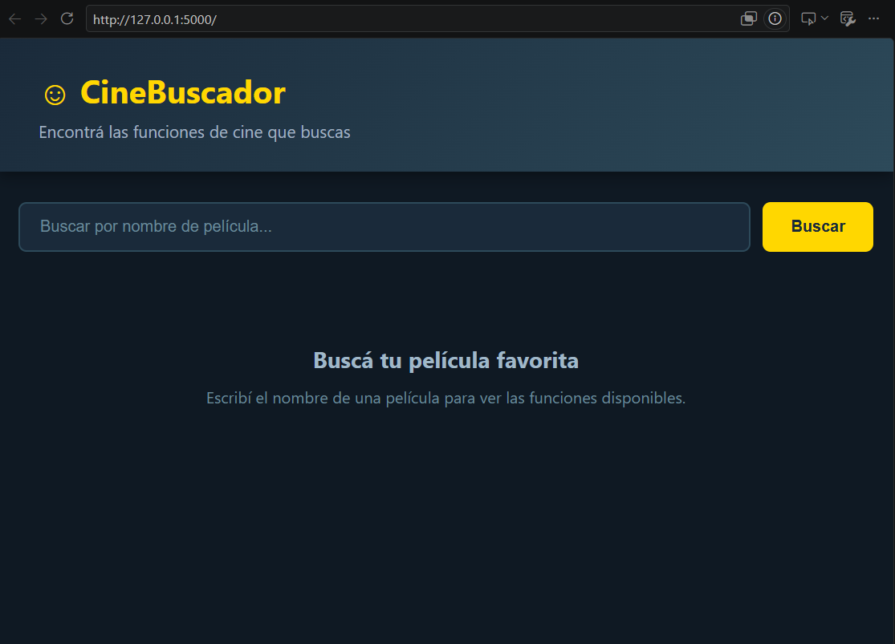

# Práctico 2

Pilar Antelo

### Marco Teórico

Las vulnerabilidades de seguridad en aplicaciones web pueden producirse cuando el sistema no valida, controla o procesa correctamente los datos proporcionados por los usuarios. Esto puede permitir que una entrada que debería ser tratada únicamente como información sea interpretada como código o como parte de una instrucción del sistema. Entre las vulnerabilidades estudiadas en este práctico se encuentran SQL Injection, Cross-Site Scripting (XSS), File Upload, Server-Side Template Injection (SSTI) y el almacenamiento inseguro de información sensible. Estas vulnerabilidades pueden permitir el acceso no autorizado a información, la ejecución de código, la modificación de datos o el compromiso del servidor.

Una de las principales medidas para prevenir este tipo de problemas consiste en separar correctamente los datos proporcionados por el usuario de las instrucciones que ejecuta la aplicación. Para esto pueden utilizarse mecanismos como consultas SQL parametrizadas, escape automático de contenido HTML, validación de archivos del lado del servidor y almacenamiento seguro de contraseñas mediante funciones de hashing diseñadas para este propósito. También es importante evitar la evaluación dinámica de entradas no confiables y proteger adecuadamente las claves y demás información sensible. Los ejercicios desarrollados a continuación permiten observar de forma práctica cómo una implementación insegura puede ser explotada y cómo diferentes mecanismos de mitigación reducen estos riesgos.

### Ejercicio 1 - Inyección SQL

En primer lugar, precisamos ejecutar el proyecto del “Ejercicio 1” que, en este caso es una app para buscar películas. Se deben seguir los siguientes pasos para comenzar:

1. Abrir Docker Desktop
2. Abrir una terminal del sistema
3. Ejecutamos `cd (ruta del ejercicio)` en la terminal
4. Ejecutamos `docker compose up --build`
5. Abrimos el puerto `http://127.0.0.1:5000/`

Si queda corriendo correctamente en el sistema se debería poder observar la aplicación del buscador de películas como en la imagen.

#### Vulnerabilidad

El objetivo del ejercicio 1 es realizar una Inyección SQL explotando una vulnerabilidad del sistema, en este caso el buscador.

La aplicación cuenta con una vulnerabilidad de SQL Injection debido a que incorpora directamente el valor ingresado por el usuario en la consulta SQL. El programa construye actualmente búsquedas tales como `WHERE peliculas.nombre LIKE '%Dune%’` , por lo que se puede colocar otra comilla `'` para cerrar esa cadena de texto dentro de la condición `LIKE` e iniciar la nuestra.  Esto permitió manipular la consulta original mediante el payload `' UNION SELECT name, sql, 0 FROM sqlite_master WHERE type='table' --`, logrando consultar información interna de la base de datos. En particular, se utilizó `sqlite_master` para obtener el nombre y la estructura de las tablas existentes, permitiendo descubrir información de la tabla **funciones** que normalmente no sería accesible desde el buscador.

Esta prueba realizada demuestra que un usuario con malas intenciones podría utilizar dicha vulnerabilidad para acceder a información de la base de datos fuera del propósito original de la aplicación.

#### Implementación de mitigación

Se modificó la función `buscar_funciones` para que se reemplace la construcción dinámica de la consulta por una parametrizada. Anteriormente, el texto ingresado se pegaba dentro del comando que iba a la base de datos, y eso hacía posible una inyección SQL.

 El cambio fue hacer que la consulta use parámetros, es decir, que el valor buscado se envíe por separado y la pase de datos lo trate solo como texto. Además para una mayor seguridad, se limitaron las opciones de orden para que solo se puedan usar valores válidos definidos por la aplicación.

### Ejercicio 2 - Cross Site Scripting

En primer lugar, precisamos ejecutar el proyecto del “Ejercicio 2” que, en este caso es una app para buscar películas. Se deben seguir los siguientes pasos para comenzar:

1. Abrir Docker Desktop
2. Abrir una terminal del sistema
3. Ejecutamos `cd (ruta del ejercicio)` en la terminal
4. Ejecutamos `docker compose up --build`
5. Abrimos el puerto `http://127.0.0.1:5000/`

Si queda corriendo correctamente en el sistema se debería poder observar la aplicación del buscador de películas como en la imagen.

#### Vulnerabilidad

El objetivo del ejercicio 2 es realizar Cross Site Scripting explotando una vulnerabilidad del sistema.

En este caso, la aplicación presenta una vulnerabilidad de Cross Site Scripting almacenado, debido a que permite ingresar y guardar contenido proporcionado por el usuario en el campo de descripción de una película sin realizar una validación. Para demostrarlo, se ingresó el código `` como descripción, al guardar y volver al buscador, el navegador interpretó dicho contenido como JavaScript y cambió el color del fondo a rojo.

Esto demuestra que se pueden ingresar scripts en una casilla que solo debería leer lo ingresado como texto. Esta vulnerabilidad en manos de una persona maliciosa podría ser explotada de otras formas como por ejemplo ingresando un script que te envíe automáticamente a otro link al ingresar a detalles de una película.

#### Implementación de mitigación

Para mitigar dicha vulnerabilidad se eliminó el filtro `safe` de “Descripción actual”. 

Normalmente Jinja, el motor de plantillas para Python que, en este proyecto Flask se encarga de generar el HTML que finalmente recibe y muestra el navegador, protege las páginas contra XSS mediante escape automático. Por ejemplo, si desde la base de datos llega ``  y en la plantilla tenemos                        `{{ pelicula.descripcion }}` , Jinja transforma los caracteres especiales para que el navegador los interprete como texto, no como HTML, entonces el navegador muestra literalmente “”. Sin embargo, al escribir `{{ pelicula.descripcion | safe }}` le estamos asegurando a Jinja que el contenido es seguro y que no lo escape, por lo tanto, si la base de datos contiene un script Jinja lo entrega al navegador tal cual y el navegador, al recibir una etiqueta `<script>,` la interpreta como código JavaScript y la ejecuta.

### Ejercicio 3 - File Upload

En primer lugar, precisamos ejecutar el proyecto del “Ejercicio 3” que, en este caso es una app para buscar películas y cargarle los afiches. Se deben seguir los siguientes pasos para comenzar:

1. Abrir Docker Desktop
2. Abrir una terminal del sistema
3. Ejecutamos `cd (ruta del ejercicio)` en la terminal
4. Ejecutamos `docker compose up --build`
5. Abrimos el puerto `http://127.0.0.1:5000/`

Si queda corriendo correctamente en el sistema se debería poder observar la aplicación del buscador de películas como en la imagen.

#### Vulnerabilidad

El objetivo del ejercicio 3 es realizar File Upload explotando una vulnerabilidad del sistema, en este caso al “Subir afiche”.

En primer lugar, creamos un archivo “prueba.html”, para comprobar que actualmente el servidor lo toma como contenido ejecutable.

Lo subimos utilizando la funcionalidad “Subir afiche” ya que actualmente el código acepta cualquier tipo de archivo y no verifica que sea una imagen.

Una vez subido el archivo, accedemos a `http://localhost:8080/uploads/prueba.html` y el navegador ejecutará el alert. Esto demuestra que el sistema actualmente permite archivos que no son necesariamente imágenes, lo que podría recaer en alguien subiendo un archivo con código malicioso para realizar acciones que no debería poder.

#### Implementación de mitigación

Para mitigar esta vulnerabilidad, simplemente se modificó el input de `upload.html` para que únicamente permita subir imágenes, de este modo se evita completamente que el sistema reciba archivos con códigos o maliciosos de cualquier forma.

### Ejercicio 4 - Server Side Template Injection

En primer lugar, precisamos ejecutar el proyecto del “Ejercicio 4” que, en este caso es una app para buscar funciones. Se deben seguir los siguientes pasos para comenzar:

1. Abrir Docker Desktop
2. Abrir una terminal del sistema
3. Ejecutamos `cd (ruta del ejercicio)` en la terminal
4. Ejecutamos `docker compose up --build`
5. Abrimos el puerto `http://localhost:8080`

Si queda corriendo correctamente en el sistema se debería poder observar la aplicación del buscador de películas como en la imagen.

#### Vulnerabilidad

El objetivo del ejercicio 4 es realizar Server Side Template Injection. explotando una vulnerabilidad del sistema, en este caso en el buscador.

La vulnerabilidad recae en que, que viene directamente del usuario, se está pasando como una expresión SpEL y luego se evalúa, por lo que el servidor interpreta las entradas como expresiones

Para comprobar la vulnerabilidad, se pueden realizar unas pruebas simples como las siguientes:

1. Ingresar en el buscador `1 + 1` , devuelve “2”

1. Ingresar `T(java.lang.Math).sqrt(144)` para consultar una propiedad de Java, devuelve “12.0”

Sin embargo, esto son pruebas sencillas y no peligrosas. La vulnerabilidad puede alcanzar una gravedad crítica si el atacante consigue utilizar SpEL para acceder a clases y métodos con capacidad de interactuar con el sistema operativo. En ese escenario, podría producirse Remote Code Execution (RCE), permitiendo ejecutar código en el servidor con los privilegios del proceso de la aplicación.

#### Implementación de mitigación

La mitigación consistió en eliminar la evaluación dinámica de expresiones SpEL sobre la entrada del usuario en el componente SpelEvaluator. A partir del cambio, la entrada buscar se trata como texto plano y no como una expresión ejecutable del lado del servidor, evitando la Server-Side Template Injection.

De este modo, si intentamos realizar una de las pruebas de antes, el servidor no lo permitirá.

### Ejercicio 5 - Almacenamiento seguro

En primer lugar, precisamos ejecutar el proyecto del “Ejercicio 5” que, en este caso es una app para buscar películas. Se deben seguir los siguientes pasos para comenzar:

1. Abrir Docker Desktop
2. Abrir una terminal del sistema
3. Ejecutamos `cd (ruta del ejercicio)` en la terminal
4. Ejecutamos `docker compose up --build`
5. Abrimos el puerto `http://localhost:8080`

Si queda corriendo correctamente en el sistema se debería poder observar la aplicación del buscador de películas como en la imagen.

#### Vulnerabilidad

El objetivo del ejercicio 5 es explotar una vulnerabilidad del sistema de almacenamiento.

Para demostrar la vulnerabilidad, ingresamos una contraseña de prueba y se aplicaron las funciones `encrypt()` y `decrypt()` de la aplicación, obteniendo primero un ciphertext y posteriormente recuperando exactamente la contraseña original. Esto demuestra que las contraseñas se almacenan mediante un mecanismo de **cifrado reversible**, en lugar de utilizar un hash diseñado específicamente para contraseñas. Esta implementación es peligrosa porque, si un atacante obtiene acceso al ciphertext y a la clave de cifrado, puede recuperar las contraseñas originales. Por este motivo, las contraseñas deberían almacenarse mediante algoritmos de hashing como **Argon2, bcrypt o scrypt**, que no permiten recuperar directamente el valor original.

Además del uso de cifrado reversible, la aplicación presenta otras vulnerabilidades relacionadas con el almacenamiento y manejo de contraseñas. En primer lugar, la **clave de cifrado se encuentra hardcodeada en el código fuente**, por lo que cualquier persona que obtenga acceso al código puede conocerla y utilizarla para descifrar las contraseñas almacenadas. También se utiliza **AES en modo ECB**, que no emplea un vector de inicialización (IV) aleatorio y permite que una misma contraseña genere siempre el mismo ciphertext, revelando posibles coincidencias entre contraseñas. Por último, la aplicación **expone el ciphertext de la contraseña en la interfaz después del inicio de sesión**, mediante `encryptedPassword`, lo que constituye una exposición innecesaria de información sensible. Estas vulnerabilidades se agravan entre sí, ya que la obtención de los valores cifrados junto con la clave hardcodeada permitiría recuperar las contraseñas originales.

#### Implementación de mitigación

En el Ejercicio 5 se mitigó la vulnerabilidad de almacenamiento inseguro de contraseñas reemplazando el esquema de cifrado reversible por un mecanismo de hashing seguro con BCrypt. Para ello, se modificó el servicio de cifrado para que ya no utilice una clave estática embebida ni el algoritmo AES/ECB, sino que genere un hash no reversible por cada contraseña; además, se actualizó el proceso de login para verificar credenciales mediante comparación contra el hash almacenado, en lugar de descifrar la contraseña original. Como medida complementaria, también se eliminó de la interfaz la visualización del valor almacenado de la contraseña. Estos cambios se realizaron para evitar que las contraseñas puedan recuperarse en texto claro si alguien accede al código fuente o a la base de datos, alineando el manejo de credenciales con una práctica básica de almacenamiento seguro.